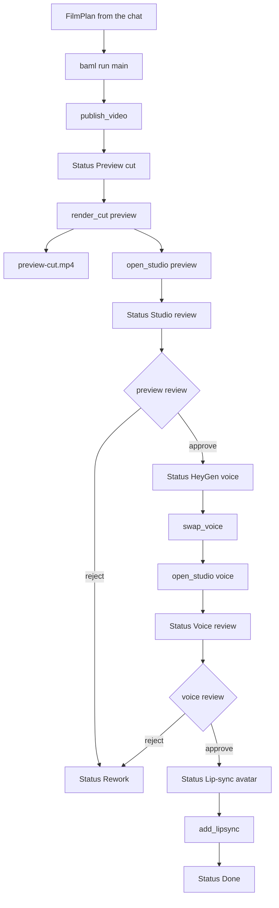

# How this repo works

Cursor writes a `FilmPlan`. BAML turns that plan into one HyperFrames folder and then walks a review pipeline. Nothing in the pipeline calls a model, and nothing calls HeyGen.

`origin/main` at `9b25b03` and this branch, `cursor/film-traces-4b19` at `f734c68`, run the same status pipeline. The merge-base is `4f6ee73`, so `main` is not an ancestor of this branch. `pad_number`, `baml_src/trace.baml`, and the test `scene filenames stay in order past nine` are on this branch. They are absent from `origin/main`. On `main`, scene files are `compositions/<number>-<id>.html` with no padding, and the public commands live in `project.baml`, `studio.baml`, and `notion.baml`. On this branch those commands are wrappers in `trace.baml`, and the old bodies are the `*_work` functions.

Hello World is the sample. Its beats are `hello`, `pipeline`, `studio`, and `bye`, each 3.5 seconds, starting at 0, 3.5, 7.0, and 10.5. `index.html` lasts 14.0 seconds. The files are `compositions/1-hello.html`, `2-pipeline.html`, `3-studio.html`, and `4-bye.html`.

## Key concepts

A `FilmPlan` is the story the chat writes. It has a title, a slug, an aspect, a palette, and beats. A beat has an id, an eyebrow, a headline, a body, and seconds. `normalize` in `baml_src/film.baml` turns that into a `Film` with pixel width and height.

A `VideoPlan` is the `plan.json` on disk. It keeps the story and adds `script`, `still`, `voice_id`, and `avatar_id`. Publish writes both ids as empty strings. They live in the JSON only. `render.baml` never puts them in the HTML.

A cut is one of three stage names. Those names are preview, voice, and lipsync. Only preview renders locally, as draft quality, to `renders/preview-cut.mp4`. The voice and lip-sync steps store HeyGen ids after a person approves. `heygen_request` builds a JSON body for a later video create and is not sent.

The card is the Hyperframes Genie row whose `Slug` matches the folder. Status values are `Preview cut`, `Studio review`, `HeyGen voice`, `Voice review`, `Lip-sync avatar`, `Done`, and `Rework`. The link property is spelled `Lastest Studio Link`. Gates read `reviews.json`, `plan.json`, and the mp4. They do not read the card.

On this branch a delivery trace is `videos/<slug>/trace.json`. The shape is a slug plus a list of stages. Each stage has a name, a stage, a status, started and ended times, an input, and an output. `origin/main` has no trace file and no `trace.baml`.

## How it works

`main` prefers `--plan_file`, then an inline `--plan`. With neither, it throws `Pass --plan_file videos/<slug>/plan.json`. `film_from_json` parses a `FilmPlan` and calls `normalize`. A saved `plan.json` can be read again that way. The test `one story makes a silent preview plan and a HeyGen production plan` passes a serialized `VideoPlan` through `film_from_json`.

`normalize` fills an empty title with `Untitled` and runs `safe_id` on the slug. An empty slug uses the title. A slug of `beat` or `main` becomes `film`. `frame_for` maps Landscape to 1920x1080, Portrait to 1080x1920, and Square to 1080x1080. `color_or` keeps a `#RRGGBB` value and otherwise uses `#12141a`, `#f4f1ea`, and `#d6ff4a`. `unique_ids` kebab-cases ids, prefixes a leading digit with `b-`, and suffixes `-2` on a collision. `clamp_seconds` forces each beat into 3 to 5 seconds. `cap_total` drops the last beat while the sum is greater than 15 and more than one beat remains. Five 3-second beats sum to 15 and stay. A sixth is dropped. An empty beat list becomes one `open` beat of 4 seconds. The count is not forced to 3 or 4.

`render_project` writes `index.html` and one composition per beat. `scene_html` uses `pipeline_html` for id `pipeline`, `studio_html` for id `studio`, and `card_html` for every other id. The index composition id is `main`. Each host keeps the beat id on the element id and on `data-composition-id`. The host slot is the full beat length. The inner clip is one tenth shorter, so a 3.5 second beat has a 3.4 second clip. Timelines are paused GSAP timelines on `window.__timelines`. Variable JSON is hand-built because `type` is a BAML keyword. `script` is the beat bodies joined with spaces. `still` defaults to `assets/avatar-still.png` and is not an image in the HTML. The studio beat hardcodes `assets/studio.png`.

`scene_src` names files `compositions/<pad>-<id>.html`. `decimal_digits` is the width of the beat count, capped at 6. Four scenes stay `1-hello.html`. Ten become `01` through `10`. One hundred become `001` through `100`. `drop_scene_aliases` deletes a bare `<id>.html` and the other pad widths from 1 through 6. That padding is on this branch only. `origin/main` interpolates the raw number.

The scene-order test builds a `Film` with `many_scenes` and skips `normalize`. A real `main` run still passes through `cap_total`. With a 3 second floor, five beats fill the 15 second budget, the width stays 1, and a published film does not get `01-` names.

`publish_video_work` scaffolds the folder if `package.json` is missing, using `HYPERFRAMES_SKIP_SKILLS=1 npx --yes hyperframes init`, then deletes `CLAUDE.md`. It writes the HTML, writes `plan.json` with empty ids, creates `renders/`, and deletes `reviews.json`, `approval.json`, and the old `preview-plan.json`, `voice-plan.json`, `lipsync-plan.json`, and `production-plan.json` names. It then calls `sync_card` with step `publish`.

`.cursor/rules/plan-films.mdc` on `HEAD` numbers five steps after that publish. Those five steps are the same on `origin/main`. This branch adds the padding paragraph and the `trace.json` paragraph.

1. `baml run render_cut -- --dir videos/<slug> --cut preview` renders the draft mp4 and opens Studio. Status becomes `Studio review`. The card receives `Lastest Studio Link` and `Silent Preview Cut (mp4)`.
2. `baml run approve -- --dir videos/<slug> --stage preview`, or `reject`. Approval sets `HeyGen voice`. Rejection sets `Rework`.
3. `baml run swap_voice -- --dir videos/<slug> --voice_id <heygen-voice>`. This does not call HeyGen. `Voice_id` is saved. Status stays `HeyGen voice`.
4. `baml run open_studio -- --dir videos/<slug> --cut voice`. Status becomes `Voice review` and the studio link is refreshed. Then `baml run approve -- --dir videos/<slug> --stage voice`. Approval sets `Lip-sync avatar`. Rejection sets `Rework`.
5. `baml run add_lipsync -- --dir videos/<slug> --avatar_id <avatar>`. `Avatar_id` is saved. Status becomes `Done`. There is no render and no further Studio step. Do not start the paid lip-sync.

`approve` and `reject` default `--stage` to `preview`. `render_cut` rejects `voice` and `lipsync` with `Only the preview cut renders`. `open_studio` rejects `lipsync` before it starts a server. A voice open requires `voice_id` and still serves the same silent HTML. Preview approval requires `renders/preview-cut.mp4` and stores the current script. `swap_voice` requires that approved preview, the same script, and a `voice_id` matching `^[A-Za-z0-9_-]*$`. It writes the voice, clears `avatar_id`, and clears the voice review. Voice approval requires a `voice_id`. Lip-sync requires the approved voice review, the same script, and the same `voice_id`.

`sync_card_work` reads `NOTION_TOKEN`, then `NOTION_API_KEY`. With neither, it returns the status string and makes no request. With a token, it queries database `a10ffad1-a332-46bc-8c0f-44c702779d92` for one `Slug` match and PATCHes that page. Empty card fields are left out of the body, so a later step does not clear an old link, voice, or avatar. A missing token and a successful PATCH return the same status string. A miss, meaning the slug does not match exactly one card, throws after the local write.

On this branch each public command goes through `with_stage`. The command runs first. After it returns, `note_stage` appends a row with blank `started` and `ended`. A thrown command appends status `error` and is rethrown. A failed trace write is swallowed. `open_studio` labels the row `voice_studio` only when the cut argument is `voice`. Every other cut argument is labeled `preview_studio`, and the work function still rejects `lipsync` and unknown cuts. One command can append several rows, because `render_cut` calls `open_studio` and that calls `sync_card`. The inner row is written first.

`film_trace` rewrites `trace.json` from `baml query --local` spans for that slug. `merge_steps` keeps a noted row when no span matches it. `same_step` compares name, stage, status, and output. It ignores timestamps and input. The rule on this branch says to run `film_trace` and commit `trace.json`. Raw spans stay in `.baml/`.

`baml test` is offline. It does not render an mp4, start HyperFrames, or call HeyGen. The film tests cover a sloppy plan, an empty plan, the demo film, escaped copy, one plan with two blocked cuts, an unknown cut, the silent plan and the HeyGen plan, the approval gate, a missing plan file, the card status names, scene filenames past nine, and the Studio URL. The four trace tests check the folder slug, query rows, a stage call, and a noted stage that has no span yet.

## Where things live

`baml_src/film.baml` holds the plan types and `normalize`. `decimal_digits`, `zeros`, and `pad_number` are in that file on this branch only.

`baml_src/plans.baml` holds `VideoPlan` and the voice and lip-sync gates.

`baml_src/render.baml` holds `render_project` and the three scene layouts.

`baml_src/main.baml` holds `main` and `resolve_film`.

`baml_src/project.baml` holds the folder writer and the `*_work` command bodies. `render_take` is an extra local render. It is not one of the five steps, and `trace.baml` does not wrap it.

`baml_src/studio.baml` holds `open_studio_work`. The preview command is `npx hyperframes@0.8.188 preview --background --json --no-open --port 3002`. Hello World opens at `http://127.0.0.1:3002/#project/hello-world`.

`baml_src/notion.baml` holds the card status map and the PATCH.

`baml_src/trace.baml` and `baml_src/trace_test.baml` exist only on this branch.

`videos/hello-world` is a HyperFrames 0.8.188 project. `.cursor/rules/plan-films.mdc` is the always-on planner rule. `.agents/skills` holds the BAML and HyperFrames skills.

Gitignore covers mp4 files, `reviews.json`, `approval.json`, `heygen-request.json`, `.hyperframes`, `node_modules`, `.thumbnails`, and `.baml`. `trace.json` is not ignored.

## Gotchas

The README and the `FilmPlan` description say three or four scenes, total under 15 seconds. `cap_total` allows a total of 15 and does not enforce a count of 3 or 4. The padding rule describes a ten-scene and a hundred-scene film. `render_project` will pad those counts. `main` will not keep them, because `cap_total` drops beats until the sum fits.

Republish writes empty `voice_id` and `avatar_id`, deletes `reviews.json` and `approval.json`, and sets Status to `Preview cut`. It leaves the mp4 and `trace.json` in place. Because empty card fields are omitted, an old studio link, voice, and avatar stay on the card.

The voice Studio session is the silent composition. `voice_id` is not in the HTML. `assets/avatar-still.png` is the stored still path, and that file is not in the Hello World folder. Only the `studio` beat shows an image, and that image is `assets/studio.png`.

A Notion miss happens after the folder write. The command fails, and the local plan or review is already updated. With no token, the command still reports the new status.

The working copy of the five Hello World HTML files has `data-hf-id` attributes. Those attributes are not in `render.baml`, not in the `HEAD` commit, and not on `origin/main`. A fresh publish emits HTML without them. Studio stamps them when the preview server is running.

`with_stage` appends the trace row after the command returns, with blank times. `film_trace` fills the times from local spans. A local failure is stored as status `error`. A query row can say `user_error`. Those two rows do not match, so both can remain after `film_trace`.
